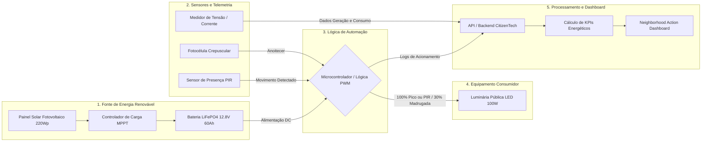

# Neighborhood Action Dashboard (CitizenTech) — Módulo SERS

**Disciplina:** Soluções em Energias Renováveis e Sustentáveis (SERS)
**Curso:** Ciência da Computação — Turmas 1CC | **Global Solution 2026.2**

---

## 👥 Integrantes do Grupo

| Nome completo | RM |
| :--- | :--- |
| Arthur Cara Souza | RM 576504 |
| José Renato Karabachian Aparício | RM 567225 |


**Links do projeto**

- **Vídeo técnico (YouTube — não listado):** [PREENCHER: cole o link do YouTube aqui]

---

## 1. Diagnóstico do Problema e Contextualização Comunitária

- **Espaço comunitário escolhido:** praça pública comunitária de bairro (área estimada de 1.500 m²), com pista de caminhada, academia ao ar livre e área de convivência.
- **Problema energético identificado:** o sistema atual usa luminárias obsoletas de Vapor de Sódio de Alta Pressão (VSA), alimentadas exclusivamente pela rede elétrica. Elas ficam a 100% de potência durante as 12 horas do período noturno (18h00 às 06h00), inclusive na madrugada, quando o fluxo de pedestres é mínimo. Isso gera desperdício de energia, alto custo recorrente para o município e emissões indiretas de gases de efeito estufa (CO₂e).
- **Público beneficiado:** moradores do entorno (cerca de 1.200 frequentadores semanais), praticantes de exercícios noturnos, estudantes que passam pela praça no retorno das aulas e a gestão pública local.
- **Condições de funcionamento da solução:** operação autônoma noturna (12 h/dia), com iluminação plena (100%) no horário de pico (18h00 às 23h00) e regime dimerizado econômico (30%) na madrugada (23h00 às 06h00). O sensor de presença aciona imediatamente 100% sempre que detecta movimento.
- **Benefícios esperados:** eliminação de 100% do consumo da rede da concessionária, maior segurança urbana (luz branca de alto índice de reprodução de cor e autonomia mesmo em quedas de energia) e redução de emissões de carbono.

---

## 2. Análise do Consumo Energético (Cenário Atual — Linha de Base)

### Premissas técnicas

| Item | Valor |

| Postes | 10 |
| Potência por poste | 280 W (lâmpada VSA de 250 W + 30 W de perda do reator magnético) |
| Potência total instalada | 10 × 280 W = 2.800 W (2,8 kW) |
| Tempo de funcionamento | 12 h/dia × 30 dias/mês = 360 h/mês |
| Tarifa média (iluminação pública / Grupo B, com tributos) | R$ 0,85/kWh |
| Fator de emissão médio do SIN (MCTI/EPE) | 0,065 kg CO₂e/kWh |

### Cálculo do consumo, custo e emissões atuais

Fórmula de energia: `E = (P × t) / 1000`

```text
Consumo diário  = (2.800 W × 12 h) / 1000 = 33,6 kWh/dia
Consumo mensal  = 33,6 kWh/dia × 30 dias  = 1.008 kWh/mês  (12.096 kWh/ano)
```

- **Custo atual:** 1.008 kWh/mês × R$ 0,85/kWh = **R$ 856,80/mês** (R$ 10.281,60/ano)
- **Emissões atuais:** 1.008 kWh/mês × 0,065 kg CO₂e/kWh = **65,52 kg CO₂e/mês** (786,24 kg CO₂e/ano)

---

## 3. Comparação Fundamentada das Alternativas Energéticas

Para atender à mesma necessidade luminotécnica da praça (~14.000 lúmens por poste, 12 h/noite, 30 dias/mês), foram avaliadas duas alternativas frente ao cenário atual.

### Alternativa 1: Retrofit para luminárias LED convencionais (rede elétrica / on-grid)

- **Descrição técnica:** substituição das 10 luminárias VSA por 10 luminárias públicas LED de 100 W (sem reator externo), ligadas à rede e operando a 100% durante 12 h/dia.
- **Consumo mensal:**

  ```text
  E_Alt1 = (10 × 100 W × 12 h) / 1000 × 30 dias = 360 kWh/mês  (4.320 kWh/ano)
  ```

- **Economia energética:** 1.008 − 360 = **648 kWh/mês** (**64,29%** de redução).
- **Investimento inicial (CAPEX):** R$ 5.000,00 (10 luminárias LED a R$ 350,00 cada + R$ 1.500,00 de mão de obra).
- **Custo operacional mensal (OPEX de energia):** 360 × R$ 0,85 = **R$ 306,00/mês** (economia de R$ 550,80/mês).
- **Payback simples:** 5.000,00 / 550,80 ≈ **9,1 meses**.
- **Impacto ambiental:** 360 × 0,065 = 23,40 kg CO₂e/mês (280,80 kg CO₂e/ano), uma redução de 505,44 kg CO₂e/ano.
- **Benefícios e limitações:** baixo investimento inicial e retorno rápido, mas mantém dependência total da rede (apagões deixam a praça às escuras) e continua desperdiçando energia na madrugada, sem fluxo de pessoas.

### Alternativa 2 (solução escolhida — fonte renovável): Sistema solar fotovoltaico autônomo (off-grid) com dimerização inteligente

- **Descrição técnica:** 10 postes solares integrados (*All-in-One*), cada um com:
  - luminária LED de 100 W;
  - painel solar monocristalino de 220 Wp;
  - bateria LiFePO₄ (12,8 V / 60 Ah = 768 Wh);
  - controlador MPPT;
  - fotocélula crepuscular;
  - sensor de presença PIR.

- **Perfil de demanda por poste/noite:**

  | Período | Regime | Cálculo | Energia |
  | :--- | :--- | :--- | ---: |
  | 18h00–23h00 | 100% (5 h) | 5 h × 100 W | 500 Wh |
  | 23h00–06h00 | Dimerizado a 30% (6 h) | 6 h × 30 W | 180 Wh |
  | 23h00–06h00 | 100% por detecção PIR (1 h acumulada) | 1 h × 100 W | 100 Wh |
  | **Total por poste** | | | **780 Wh/dia (0,78 kWh/dia)** |

- **Demanda total das luminárias (10 postes):** 7,8 kWh/dia × 30 = **234 kWh/mês** (redução física de **76,79%** frente à linha de base).
- **Geração solar fotovoltaica** (irradiação média de 4,5 kWh/m²·dia e eficiência global do sistema de 80%):

  ```text
  G_mensal = 10 × (0,22 kWp × 4,5 h × 0,80) × 30 dias = 237,6 kWh/mês
  ```

- **Consumo da rede elétrica pública:** **0 kWh/mês** (100% atendido por fonte solar).
- **Investimento inicial (CAPEX):** R$ 18.500,00 (10 conjuntos completos: poste + painel 220 Wp + bateria LiFePO₄ + LED 100 W + instalação).
- **Custo operacional mensal (OPEX de energia):** **R$ 0,00/mês** (economia de R$ 856,80/mês).
- **Payback simples:** 18.500,00 / 856,80 ≈ **21,6 meses** (~1,8 ano).
- **Impacto ambiental:** **0 kg CO₂e/ano** na operação (786,24 kg CO₂e/ano evitados).
- **Benefícios e limitações:** elimina a conta de energia, opera de forma independente mesmo com falhas da rede e combina eficiência (LED + PIR) com geração limpa. Exige maior investimento inicial e ausência de sombreamento de copas de árvores sobre os painéis.

### Quadro comparativo resumido

| Critério | Cenário atual (VSA, rede) | Alternativa 1 (LED, rede) | Alternativa 2 (solar off-grid + PIR) |
| :--- | :--- | :--- | :--- |
| **Fonte de energia** | 100% rede elétrica | 100% rede elétrica | **100% solar fotovoltaica (renovável)** |
| **Demanda física das lâmpadas** | 1.008 kWh/mês | 360 kWh/mês | **234 kWh/mês** |
| **Consumo da rede elétrica** | 1.008 kWh/mês | 360 kWh/mês | **0 kWh/mês** |
| **Investimento inicial (CAPEX)** | R$ 0,00 | R$ 5.000,00 | **R$ 18.500,00** |
| **Custo mensal de energia (OPEX)** | R$ 856,80/mês | R$ 306,00/mês | **R$ 0,00/mês** |
| **Economia mensal na fatura** | — | R$ 550,80/mês (64,3%) | **R$ 856,80/mês (100%)** |
| **Payback simples** | — | 9,1 meses | **21,6 meses** |
| **Emissões operacionais (CO₂e)** | 786,24 kg/ano | 280,80 kg/ano | **0 kg/ano (786,24 kg evitados)** |

---

## 4. Diagrama Conceitual da Solução



---

## 5. Indicadores de Eficiência e Sustentabilidade (KPIs)

| Indicador (KPI) | Unidade | Cenário atual | Cenário proposto | Fórmula / premissa |
| :--- | :--- | :--- | :--- | :--- |
| **Consumo da rede elétrica** | kWh/mês | 1.008 | **0** | `E_rede = max(0, E_demanda − G_solar)` |
| **Economia energética total** | kWh/mês e % | 0 (0%) | **1.008 kWh/mês (100%)** | `ΔE = E_atual − E_rede` |
| **Redução estimada de custos** | R$/mês | R$ 0,00 | **R$ 856,80/mês** | `ΔC = ΔE × R$ 0,85/kWh` |
| **Participação de energia renovável** | % | 0% | **100%** | `%renov = (G_solar / E_demanda) × 100` |
| **Emissões evitadas estimadas** | kg CO₂e/ano | 0 | **786,24 kg CO₂e/ano** | `ΔCO₂ = ΔE_anual × 0,065 kg CO₂e/kWh` |

---

## 6. Integração ao Neighborhood Action Dashboard

O módulo energético da disciplina SERS foi integrado ao *Neighborhood Action Dashboard* por meio do arquivo de dados e métricas `src/data/sersEnergyData.js`, que permite a visualização comparativa entre cenários e o acompanhamento dos indicadores comunitários:

```javascript
// src/data/sersEnergyData.js
export const sersEnergyData = {
  spaceName: "Praça Comunitária Central — Setor 01",
  areaM2: 1500,
  polesCount: 10,
  tariffBRL: 0.85,
  co2FactorKgPerKwh: 0.065,
  scenarios: [
    {
      id: "baseline",
      label: "Cenário Atual (VSA 280W Rede)",
      gridConsumptionKwhMonth: 1008,
      solarGenerationKwhMonth: 0,
      monthlyCostBRL: 856.80,
      capexBRL: 0,
      annualCo2Kg: 786.24,
      renewableSharePct: 0,
    },
    {
      id: "alt1_led",
      label: "Alt. 1: LED 100W (Rede)",
      gridConsumptionKwhMonth: 360,
      solarGenerationKwhMonth: 0,
      monthlyCostBRL: 306.00,
      capexBRL: 5000.00,
      annualCo2Kg: 280.80,
      renewableSharePct: 0,
    },
    {
      id: "alt2_solar_pir",
      label: "Alt. 2: Solar Off-Grid 220Wp + PIR",
      gridConsumptionKwhMonth: 0,
      solarGenerationKwhMonth: 237.6,
      monthlyCostBRL: 0.00,
      capexBRL: 18500.00,
      annualCo2Kg: 0,
      renewableSharePct: 100,
    },
  ],
  kpis: [
    { id: "grid_savings", title: "Economia na Rede", value: "1.008 kWh/mês", subtitle: "Redução de 100%" },
    { id: "cost_savings", title: "Redução de Custos", value: "R$ 856,80/mês", subtitle: "Payback em 21,6 meses" },
    { id: "renewable_share", title: "Energia Renovável", value: "100%", subtitle: "237,6 kWh/mês gerados" },
    { id: "co2_avoided", title: "Emissões Evitadas", value: "786,24 kg CO₂e/ano", subtitle: "Zero emissão operacional" },
  ],
};
```

---

## 7. Referências e Limitações da Proposta

### Referências

1. **ANEEL** — Agência Nacional de Energia Elétrica. *Tarifas de Fornecimento de Energia Elétrica (Iluminação Pública / Grupo B)*.
2. **EPE / MCTI** — Empresa de Pesquisa Energética e Ministério da Ciência, Tecnologia e Inovação. *Fatores de Emissão de CO₂ pela Geração de Energia Elétrica no Sistema Interligado Nacional (SIN)*.
3. **CRESESB / CEPEL** — Centro de Referência para as Energias Solar e Eólica Sérgio de Salvo Brito. *Potencial Solarimétrico Brasileiro (Irradiação Solar Média Diária)*.

### Limitações e premissas condicionantes

- As estimativas de geração solar (237,6 kWh/mês) e de economia financeira (R$ 856,80/mês) são projeções condicionadas à irradiação média histórica (4,5 kWh/m²·dia) e ao perfil estimado de acionamento do sensor de presença na madrugada.
- Sequências prolongadas de dias chuvosos ou nublados reduzem a geração diária. O risco é mitigado pela reserva da bateria LiFePO₄ (768 Wh por poste, com autonomia de quase duas noites completas em modo econômico).
- O investimento inicial (CAPEX) não contempla a troca futura do banco de baterias (vida útil estimada de 5 a 7 anos) nem custos eventuais de manutenção corretiva contra vandalismo.
